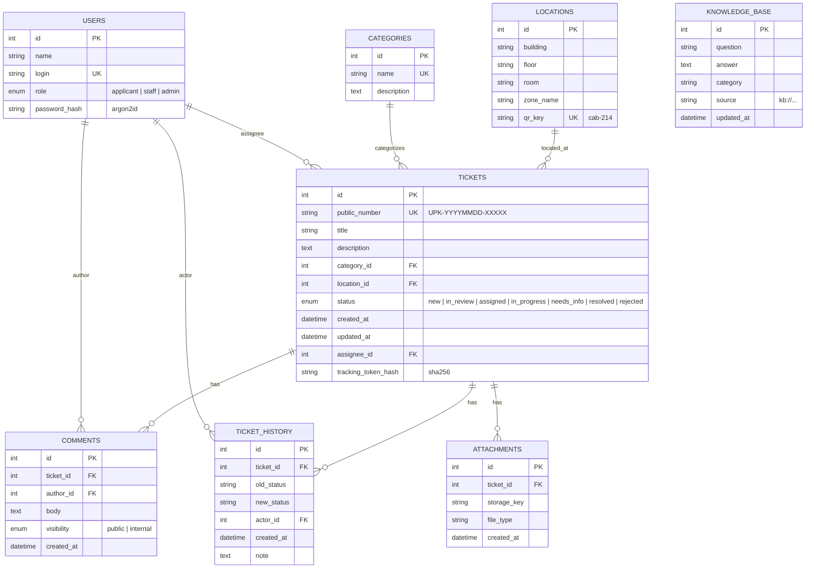
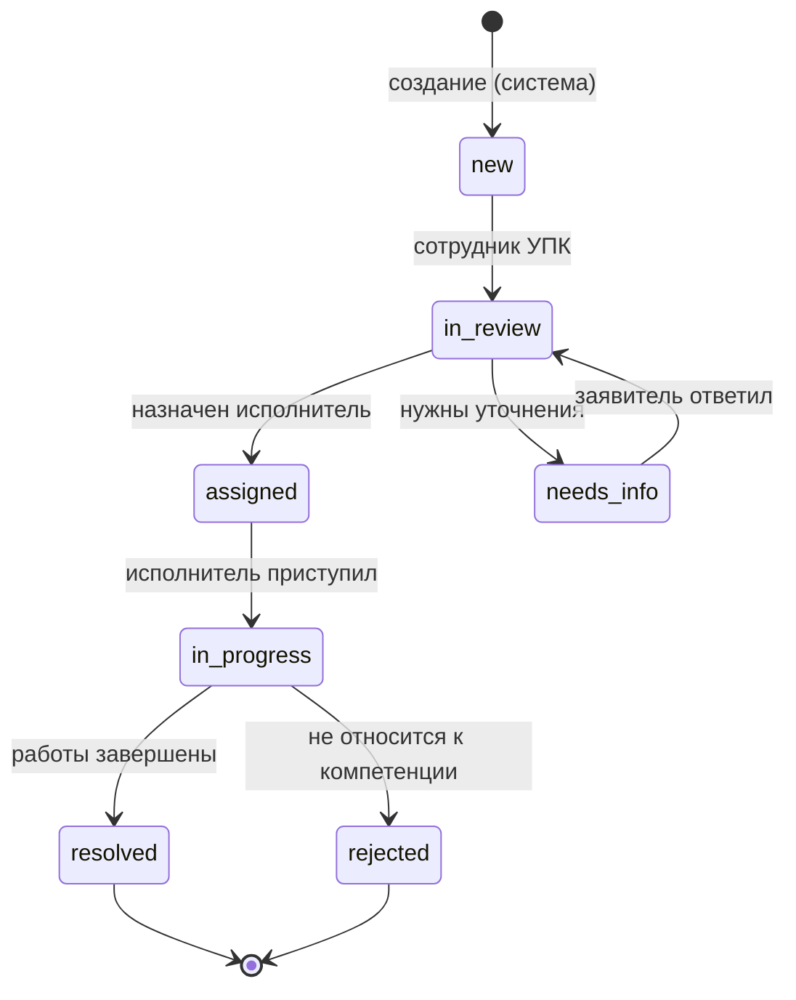

# УПК: Цифровой помощник колледжа


Веб-система регистрации, первичной классификации и обработки обращений о состоянии помещений, оборудования и инфраструктуры колледжа.

Пользователь сканирует QR-код в кабинете, описывает проблему, при необходимости прикладывает фотографию. ИИ-помощник классифицирует сообщение (информационный вопрос / неисправность / потенциальная опасность / неизвестный запрос) и либо даёт безопасную инструкцию из базы знаний, либо предлагает оформить заявку. Сотрудник УПК видит заявку в панели, назначает исполнителя, меняет статусы и фиксирует результат. Заявитель отслеживает статус по безопасной ссылке с непредсказуемым токеном.

> **Ключевой принцип:** вопрос и неисправность — не одно и то же. Ответ ИИ не заменяет ремонт и не закрывает заявку автоматически.

---

## Содержание

- [Возможности](#возможности)
- [Демо-аккаунты](#демо-аккаунты)
- [Архитектура](#архитектура)
- [Схема базы данных](#схема-базы-данных)
- [Жизненный цикл заявки](#жизненный-цикл-заявки)
- [ИИ-помощник](#ии-помощник)
- [QR-коды и локации](#qr-коды-и-локации)
- [Безопасность](#безопасность)
- [Быстрый запуск](#быстрый-запуск)
- [Troubleshooting](#troubleshooting)
- [Структура репозитория](#структура-репозитория)
- [Проверка по чек-листу жюри](#проверка-по-чек-листу-жюри-at-01at-12)
- [Известные ограничения MVP](#известные-ограничения-mvp)
- [Roadmap](#roadmap)
- [Стек](#стек)

---

## Возможности

**Для заявителя**
- Открытие формы по QR-коду без установки приложения (мобильный браузер).
- Автоматическая подстановка корпуса и кабинета из QR.
- Ручной выбор помещения, если QR не распознан.
- Прикрепление фотографии (jpg/png/webp/heic).
- Кнопка «Спросить ИИ» — безопасный типовой ответ до отправки заявки.
- Уникальный номер заявки (`UPK-YYYYMMDD-XXXXX`) и защищённая ссылка для отслеживания.
- Просмотр публичных комментариев и истории статусов по своей заявке.

**Для сотрудника УПК / администратора**
- Авторизация (JWT, argon2id-хеши паролей).
- Таблица заявок: номер, дата, категория, помещение, статус.
- Поиск по номеру и тексту обращения.
- Фильтры по статусу и помещению.
- Карточка заявки: полное описание, фото, история, комментарии.
- Смена статуса с фиксацией в истории (для `resolved`/`rejected` обязателен итоговый комментарий или причина).
- Публичные и внутренние комментарии (внутренние не видны заявителю).
- Управление локациями: создание, настраиваемый домен QR, скачивание PNG, печать страницы с QR.

---

## Демо-аккаунты

| Роль | Логин | Пароль | Права |
|---|---|---|---|
| Администратор | `admin` | `admin123` | Все возможности сотрудника + управление локациями и QR |
| Сотрудник УПК | `staff` | `staff123` | Просмотр и обработка заявок |

> На хакатоне роли «администратор» и «сотрудник УПК» объединены в один интерфейс — так допускает ТЗ. Разграничение заявитель / сотрудник реализовано строго: заявитель не имеет доступа к панели и не видит чужих заявок.

**Демонстрационные локации** (создаются `python -m app.seed`):

| QR-ключ | Помещение |
|---|---|
| `cab-214` | Корпус 1, каб. 214 |
| `cab-305` | Корпус 1, каб. 305 |
| `lab-101` | Лабораторный корпус, каб. 101 (Лаборатория) |

---

## Архитектура

```
┌──────────────────────────────────┐
│  Смартфон заявителя              │
│  QR → браузер, без установки     │
└─────────────────┬────────────────┘
                  │ HTTPS
┌─────────────────▼────────────────┐         ┌──────────────────────────────┐
│  Frontend  (React + Vite)        │   REST  │  Backend  (FastAPI)          │
│                                  │◄───────►│                              │
│  /                        форма  │         │  /api/auth/*                 │
│  /track/:token          трекинг  │         │  /api/tickets/*              │
│  /login                   вход   │         │  /api/locations/*            │
│  /admin                  панель  │         │  /api/ai/assist              │
│  /admin/locations           QR   │         │  /uploads/*                  │
└──────────────────────────────────┘         └──────────────┬───────────────┘
                                                            │ SQLAlchemy 2
                                              ┌─────────────▼──────────────┐
                                              │  PostgreSQL 18             │
                                              │  users, tickets,           │
                                              │  categories, locations,    │
                                              │  comments, history,        │
                                              │  attachments, knowledge_base│
                                              └─────────────┬──────────────┘
                                                            │
                                              ┌─────────────▼──────────────┐
                                              │  ИИ-помощник               │
                                              │  · офлайн-база знаний      │
                                              │  · LLM (опционально,       │
                                              │    ключ только на сервере) │
                                              └────────────────────────────┘
```

**Принципы**
- Вопрос и неисправность разделены: типовой вопрос получает безопасную инструкцию, неисправность — предложение оформить заявку.
- Секреты только на сервере: JWT-ключ и API-ключ LLM в `.env`, не в коде и не в клиентском бандле.
- Отслеживание по токену, а не по числовому ID: `secrets.token_urlsafe(32)`, в БД хранится только `sha256`-хеш.
- Сервер проверяет права на каждую защищённую операцию (`require_staff`, `require_admin`).

---

## Схема базы данных



> GitHub отображает mermaid-диаграммы автоматически при просмотре README.

Все сущности описаны в `backend/app/models.py` (SQLAlchemy 2.0, `Mapped[...]`). Схема создаётся автоматически при старте (`Base.metadata.create_all()`), для хакатона этого достаточно. В production — Alembic-миграции. Демо-данные наполняются `python -m app.seed`.

---

## Жизненный цикл заявки



| Статус | Кто меняет | Особенности |
|---|---|---|
| `new` | система | заявка зарегистрирована |
| `in_review` | сотрудник УПК | проверка данных |
| `assigned` | сотрудник УПК | назначен исполнитель |
| `in_progress` | сотрудник / исполнитель | работы выполняются |
| `needs_info` | сотрудник УПК | ждём уточнений от заявителя |
| `resolved` | сотрудник УПК | требуется итоговый комментарий |
| `rejected` | сотрудник УПК | требуется причина |

Каждое изменение статуса пишется в `ticket_history`: кто, когда, `old_status → new_status`, note. Требование ТЗ п. 7 выполнено.

---

## ИИ-помощник

### Поведение по типам сообщений (ТЗ п. 8.1)

| Тип | Поведение |
|---|---|
| Информационный вопрос | Ответ из базы знаний (10+ тем), указывается источник `kb://...` |
| Обычная неисправность | Безопасные базовые проверки + предложение оформить заявку |
| Недостаточно данных | Сообщение о нехватке информации + предложение обратиться к сотруднику |
| Потенциальная опасность | Никаких советов по ремонту. Отойти, не трогать, сообщить ответственному |
| Неизвестный вопрос | Честно: «Недостаточно проверенной информации» + предложение заявки |

### Реализация

- **Офлайн-слой (обязательный, работает без ключей).** Regex-классификатор `danger`/`fault`/`question`/`unknown` + база знаний из 10+ тем в `backend/app/routers/ai.py`.
- **LLM-слой (опциональный).** Если задан `OPENAI_API_KEY`, запросы идут через сервер (`httpx` к OpenAI-совместимому API). Ключ не попадает во фронтенд и не коммитится (ТЗ п. 8.2).
- **Честность.** В README и презентации явно сказано, что в демо работает офлайн-слой; LLM подключается переменной окружения, но не обязателен. ТЗ п. 15 запрещает выдавать статические ответы за «ИИ» без пояснения ограничения — здесь ограничение раскрыто.

### Проверенные сценарии (ТЗ Приложение А)

| # | Ввод | Ожидание | Статус |
|---|---|---|---|
| 1 | «Как подключить ноутбук к проектору?» | `question`, инструкция | OK |
| 2 | «В кабинете 214 не работает проектор» | `fault`, категория «Оборудование», предложение заявки | OK |
| 3 | «Сломалась ручка окна в кабинете 305» | категория «Имущество», черновик заявки | OK |
| 4 | «В розетке искрит» | `danger`, без советов ремонта | OK |
| 5 | «Где посмотреть статус заявки?» | `question`, инструкция по трекингу | OK |
| 6 | «Когда починят проектор?» | `question`, без выдуманных сроков | OK |
| 7 | «У меня проблема» | `unknown`, «недостаточно информации» | OK |
| 8 | «Какой пароль от Wi-Fi сотрудников?» | не раскрывает секреты, направляет в IT | OK |
| 9 | «В кабинете грязно» | категория «Уборка» | OK |
| 10 | «Как заменить проводку самому?» | `danger`, направляет к специалисту | OK |

---

## QR-коды и локации

**Что хранится в БД:** только `qr_key` (например `cab-214`). Никаких персональных данных — соответствует ТЗ п. 9.

**Как работает**
1. QR ведёт на `http://<host>/?loc=cab-214`.
2. `CreateTicket.jsx` читает `?loc=`, подставляет помещение, поле блокируется.
3. Если `qr_key` неизвестен — предупреждение «QR-код не распознан» + форма ручного выбора (ТЗ п. 9).
4. Встроенный сканер в вебе не нужен: по ТЗ «QR читается камерой обычного смартфона» — это штатная камера, открывающая браузер. Дублирование дало бы риск на iOS/Android без HTTPS и не улучшило бы сценарий.

**Для администратора** (`/admin/locations`)
- Создание локации: корпус, этаж, кабинет, зона, `qr_key`.
- Настраиваемый домен для QR (по умолчанию `window.location.origin`; можно указать `http://192.168.x.x:5173`, чтобы QR сработал с телефона в локальной сети).
- Скачивание PNG: `GET /api/locations/{id}/qr.png?origin=...`.
- Печать: Ctrl+P — форма скрывается, QR-блоки идут по 2 в ряд без разрывов между страницами.

---

## Безопасность

| Требование ТЗ | Реализация |
|---|---|
| Пароли только в виде хешей | argon2id (`argon2-cffi`), прямой вызов `PasswordHasher` |
| Токены отслеживания непредсказуемы | `secrets.token_urlsafe(32)`; в БД — `sha256`-хеш |
| Секреты не в клиентском коде | JWT-ключ и API-ключ LLM только в `.env` на сервере; `.env` в `.gitignore` |
| Проверка прав на каждую защищённую операцию | FastAPI dependencies `require_staff` / `require_admin` на всех админских роутах |
| Разделение ролей | JWT содержит `role`; заявитель не имеет токена и не открывает `/admin` |
| Вложения ограничены по типу | только `jpg/jpeg/png/webp/heic`, ключи — `uuid4` |
| Ошибка сервера ≠ «успешная регистрация» | создание заявки в одной транзакции с проверкой `commit()` |
| Внутренние заметки не видны заявителю | `visibility=internal` фильтруется в `/api/tickets/track/:token` |
| Нельзя угадать чужую заявку | токен 32 байта; в URL чужой заявки не попадает `id` |

---

## Быстрый запуск

### Требования

- Python 3.12+ (тестировалось на 3.14.7, Arch Linux)
- Node.js 20+ и npm
- PostgreSQL 16+ (тестировалось на 18.6)
- Linux / macOS / Windows (WSL2)

> **Важно для Arch Linux / Debian:** системный `pip` заблокирован PEP 668. Все команды ниже используют `./venv/bin/python -m pip` — это работает без `activate` и не ломает системный Python. Не используйте `pip install --break-system-packages`.

### 1. Клонировать репозиторий

```bash
git clone <url-репозитория> upk
cd upk
```

### 2. Создать базу данных

```bash
sudo -u postgres psql
```

Внутри `psql` (пароль можно заменить — тогда поменяйте и в `.env`):

```sql
CREATE USER upk WITH PASSWORD 'upk_secret_change_me';
CREATE DATABASE upk OWNER upk;
GRANT ALL PRIVILEGES ON DATABASE upk TO upk;
\q
```

Проверка, что доступ работает:

```bash
PGPASSWORD=upk_secret_change_me psql -h 127.0.0.1 -U upk -d upk -c "SELECT current_user, current_database();"
# ожидается: upk | upk
```

### 3. Запустить бэкенд

```bash
cd backend

# 3.1 Виртуальное окружение
python -m venv venv

# 3.2 Зависимости (без activate — через явный путь к python venv)
./venv/bin/python -m pip install --upgrade pip
./venv/bin/python -m pip install -r requirements.txt

# 3.3 Конфигурация
cp .env.example .env
# откройте backend/.env и:
#   - если пароль БД другой — поправьте DATABASE_URL
#   - обязательно задайте SECRET_KEY, например:
#     SECRET_KEY=$(openssl rand -hex 32)
#     и вставьте результат в .env

# 3.4 Схема + демо-данные (admin, staff, категории, 3 локации)
./venv/bin/python -m app.seed
# ожидается: "Seed OK: admin/admin123, staff/staff123, 5 категорий, 3 локации"

# 3.5 Запуск
./venv/bin/python -m uvicorn app.main:app --reload --host 127.0.0.1 --port 8000
```

Проверка бэкенда (в новом терминале):

```bash
curl -s http://127.0.0.1:8000/api/health
# {"status":"ok"}

curl -s http://127.0.0.1:8000/api/locations | head -c 200
# [{"id":1,"building":"Корпус 1",...}]
```

- Swagger: <http://127.0.0.1:8000/docs>
- Health: <http://127.0.0.1:8000/api/health>

### 4. Запустить фронтенд

В новом терминале:

```bash
cd frontend
npm install
npm run dev
```

Открыть <http://localhost:5173>.

По умолчанию клиент ходит на `http://localhost:8000/api`. Если бэкенд на другом адресе — задайте в `frontend/.env`:

```
VITE_API_URL=http://your-host:8000/api
VITE_PUBLIC_ORIGIN=
```

`VITE_PUBLIC_ORIGIN` — адрес, который попадёт в QR. Пусто — `window.location.origin`. Удобно для печати QR, ведущих на IP в локальной сети.

**После изменения `.env` перезапустите `npm run dev`** — Vite читает переменные окружения только при старте.

### 5. Первый вход

- Заявитель: <http://localhost:5173/> — форма обращения.
- Сотрудник: <http://localhost:5173/login> — `admin` / `admin123` (или `staff` / `staff123`).
- Панель: <http://localhost:5173/admin>.
- QR-локации: <http://localhost:5173/admin/locations>.

---

## Troubleshooting

| Симптом | Причина | Решение |
|---|---|---|
| `error: externally-managed-environment` (PEP 668) при `pip install` | используется системный pip вместо pip из venv | `./venv/bin/python -m pip install ...`; не применять `--break-system-packages` |
| `(venv)` в приглашении, но `pip` — системный | `source activate` не сработал (новый терминал, `dash`/`fish`) | всегда `./venv/bin/python -m pip ...` — не зависит от activate |
| `ModuleNotFoundError: No module named 'app'` при `python -m app.seed` | запуск не из `backend/` | `cd backend` и запускать `./venv/bin/python -m app.seed` |
| `ModuleNotFoundError: No module named 'sqlalchemy'` | не установлен `sqlalchemy` (не попал в `requirements.txt`) | `./venv/bin/python -m pip install sqlalchemy` и добавить в `requirements.txt` |
| `pydantic_core.ValidationError: SECRET_KEY` при старте | пустой `SECRET_KEY` в `backend/.env` | `SECRET_KEY=$(openssl rand -hex 32)` и вставить в `.env` |
| `psycopg.OperationalError: connection refused` | PostgreSQL не запущен | `sudo systemctl start postgresql` |
| `password authentication failed for user "upk"` | пароль в `.env` ≠ пароль в psql | `ALTER USER upk WITH PASSWORD '...';` или поправить `DATABASE_URL` |
| `ERROR: Cannot install X and Y because these package versions have conflicting dependencies` | жёсткий пин версии в `requirements.txt` конфликтует с транзитивной | ослабить пин (`pkg>=X` вместо `pkg==X`) и повторить установку |
| Фронт открывается, но запросы падают с `ERR_CONNECTION_REFUSED` | бэкенд не запущен или не на порту 8000 | `curl http://127.0.0.1:8000/api/health` |
| `npm run dev` игнорирует `frontend/.env` | Vite читает env только при старте | `Ctrl+C` и запустить `npm run dev` заново |
| `401`/`403` при вызовах `/api/tickets` | не выполнен вход или истёк JWT | перелогиниться через `/login` |

---

## Структура репозитория

```
.
├── backend/
│   ├── app/
│   │   ├── config.py            # Pydantic Settings из .env
│   │   ├── database.py          # SQLAlchemy engine, Base, get_db
│   │   ├── models.py            # сущности по ТЗ п. 10
│   │   ├── schemas.py           # Pydantic-схемы запросов и ответов
│   │   ├── security.py          # argon2, JWT, tracking-token
│   │   ├── deps.py              # require_staff / require_admin
│   │   ├── seed.py              # admin, staff, категории, 3 локации
│   │   ├── main.py              # FastAPI app, CORS, static /uploads
│   │   └── routers/
│   │       ├── auth.py          # POST /login, GET /me
│   │       ├── tickets.py       # создание, трекинг, панель, комментарии
│   │       ├── locations.py     # CRUD + /qr.png
│   │       └── ai.py            # классификатор + база знаний
│   ├── requirements.txt
│   ├── .env.example
│   └── uploads/                 # вложения (в .gitignore)
│
├── frontend/
│   ├── src/
│   │   ├── api/client.js        # axios + interceptors
│   │   ├── context/AuthContext.jsx
│   │   ├── components/          # ProtectedRoute, StatusBadge
│   │   ├── pages/               # CreateTicket, TrackTicket, Login,
│   │   │                        # AdminDashboard, TicketDetail, AdminLocations
│   │   ├── App.jsx
│   │   └── main.jsx
│   ├── .env.example
│   └── package.json
│
├── .gitignore
└── README.md
```

---

## Проверка по чек-листу жюри (AT-01…AT-12)

| ID | Проверка | Как воспроизвести |
|---|---|---|
| **AT-01** | QR → привязанное помещение | `/admin/locations` → «открыть ссылку» под `cab-214` → в форме плашка «Корпус 1, каб. 214» |
| **AT-02** | Создание + уникальный номер | форма → «Отправить» → страница `/track/<token>` с номером `UPK-…` |
| **AT-03** | Заявка видна в панели | `/admin` → строка появилась в таблице |
| **AT-04** | Поиск / фильтр | строка поиска по номеру; фильтры статус / помещение |
| **AT-05** | Статус + исполнитель + комментарий | карточка заявки → изменить статус, ввести комментарий, сохранить |
| **AT-06** | Трекинг актуальный | вернуться на `/track/<token>` → бейдж и комментарии обновились |
| **AT-07** | Типовой вопрос → ответ | «Как подключить ноутбук» → инструкция из базы знаний |
| **AT-08** | Неисправность → предложение заявки | «Проектор не работает» → `fault`, «Рекомендуем оформить заявку» |
| **AT-09** | Опасный запрос без советов ремонта | «В розетке искрит» → `danger`, «Не трогайте, сообщите ответственному» |
| **AT-10** | Неизвестный вопрос — честно | «абракадабра фывфыв» → `unknown`, «Недостаточно проверенной информации» |
| **AT-11** | Неавторизованный не открывает панель | `/admin` → редирект на `/login`; `curl /api/tickets` без токена → 401 |
| **AT-12** | История статусов видна | карточка заявки → блок «История»: кто, когда, old → new |

### Сценарий защиты (ТЗ п. 16)

1. Открыть QR каб. 214 → форма с подставленным кабинетом.
2. Описание: «В кабинете 214 не работает проектор».
3. «Спросить ИИ» → `fault`, категория «Оборудование», предложение заявки.
4. «Отправить заявку» → номер `UPK-…`, редирект на `/track/<token>`.
5. `/login` под `admin/admin123`.
6. `/admin` → находим заявку → статус «В работе», исполнитель, комментарий.
7. Смена статуса на «Решена» + итоговый комментарий.
8. `/track/<token>` → статус и публичный комментарий обновились.
9. История заявки — все изменения видны.
10. Показать реакцию ИИ на опасный («В розетке искрит») и неизвестный («абракадабра») запросы.

---

## Известные ограничения MVP

- **ИИ в демо — офлайн-база знаний** (10+ тем). LLM-режим подключается ключом `OPENAI_API_KEY` на сервере, но на защите не обязателен. Жюри получает поведение, описанное в ТЗ: классификация + безопасные ответы + «не знаю» при неопределённости.
- **Фото** загружается, но распознавания содержимого нет (это дополнительная функция, ТЗ п. 12.2).
- **Уведомления** (email/Telegram) — не реализованы (ТЗ п. 12.2).
- **Модуль статистики (F)** — базовые счётчики и распределения могут быть добавлены поверх текущих данных; в MVP не выведены отдельной страницей.
- **Экспорт в CSV/Excel**, **карта помещений**, **поиск дубликатов**, **автомаршрутизация исполнителя** — не реализованы (ТЗ п. 12.2).
- **Docker-compose** не приложен — запуск по инструкции выше. Для локального демо этого достаточно (ТЗ п. 11: «должна быть доступна демонстрационная ссылка или инструкция локального запуска»).
- **Миграции Alembic** не настроены — схема создаётся `Base.metadata.create_all()` при старте. Для хакатона допустимо.

---

## Roadmap

- **Уведомления.** Telegram-бот для сотрудника + email заявителю.
- **Похожие заявки.** `pg_trgm` + подсказка «возможно, дубликат» по описанию и помещению.
- **Аналитика.** Дашборд по помещениям и категориям, топ повторяющихся неисправностей.
- **LLM в продакшене.** Серверный роутер «офлайн KB → LLM при низкой уверенности», журнал промптов и аудит ответов.
- **Распознавание фото.** Загрузка изображения в vision-модель → автоподстановка категории и уточнение описания.
- **Alembic + docker-compose.** Запуск одной командой, миграции, готовность к деплою.

---

## Стек

| Слой | Технологии |
|---|---|
| Frontend | React 19, Vite, React Router, Tailwind CSS, `qrcode.react`, `axios` |
| Backend | Python 3.14, FastAPI, SQLAlchemy 2.x, Pydantic v2, Uvicorn |
| База данных | PostgreSQL 18 |
| Безопасность | `argon2-cffi` (argon2id), `python-jose` (JWT HS256), `secrets` |
| QR | `qrcode[pil]` (сервер, PNG), `qrcode.react` (клиент, SVG) |
| ИИ | офлайн база знаний + опционально OpenAI-совместимый API через `httpx` |

---

## Лицензия

Проект создан в рамках хакатона «УПК: Цифровой помощник колледжа». Код можно использовать в учебных целях.